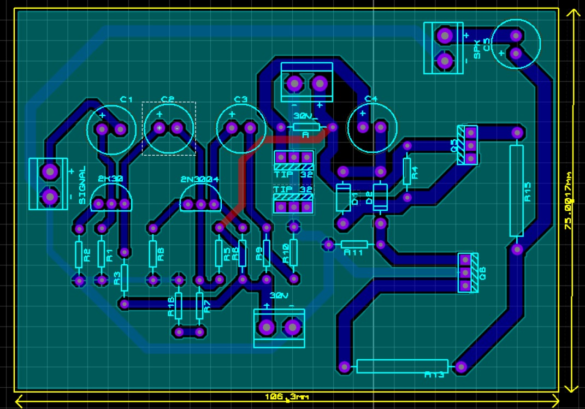
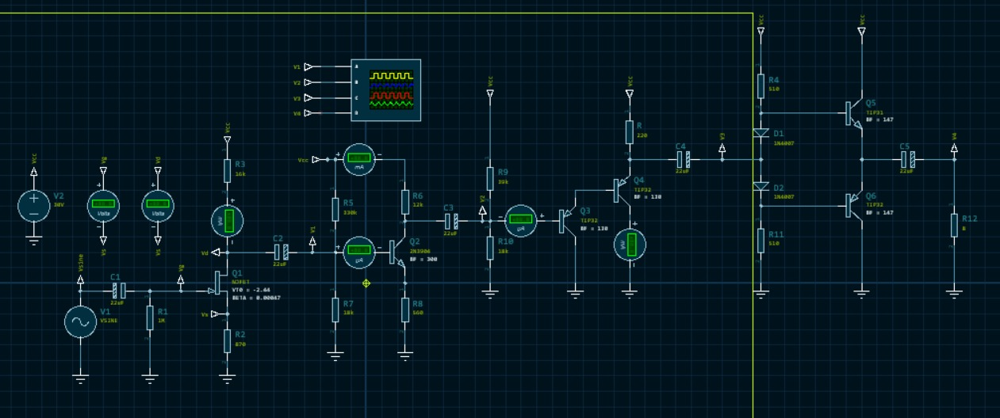
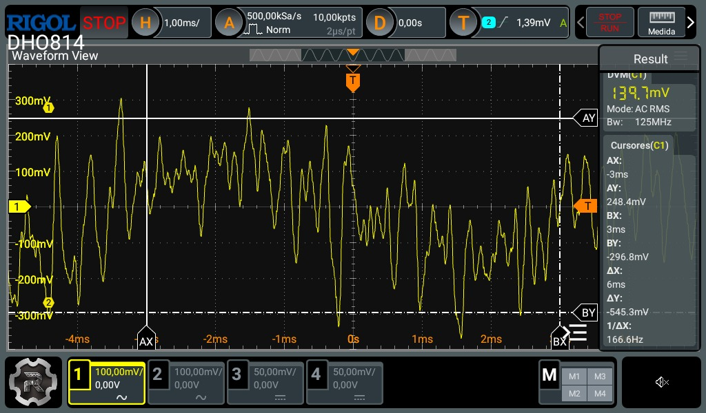
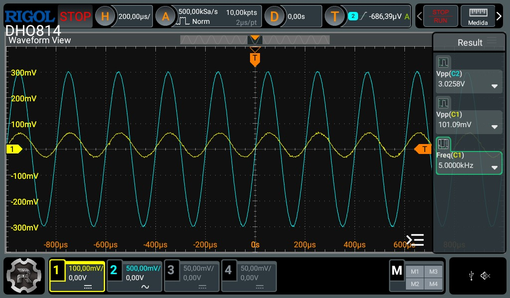
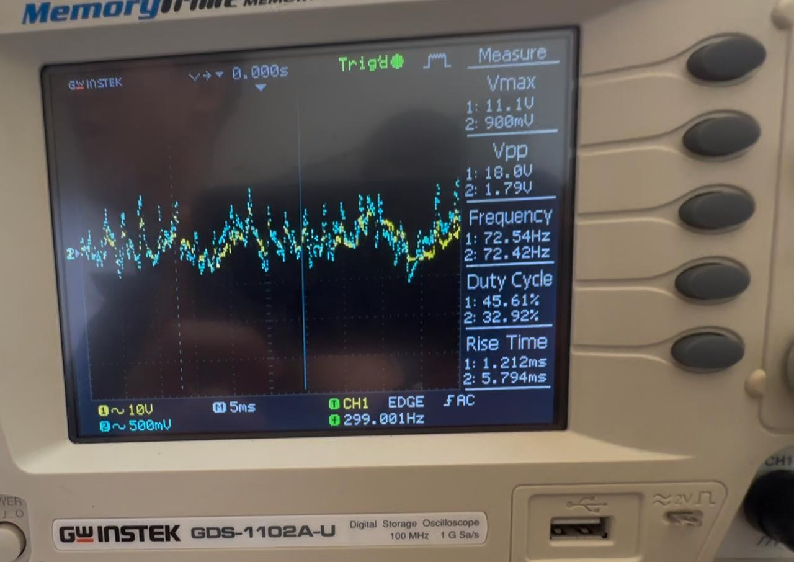
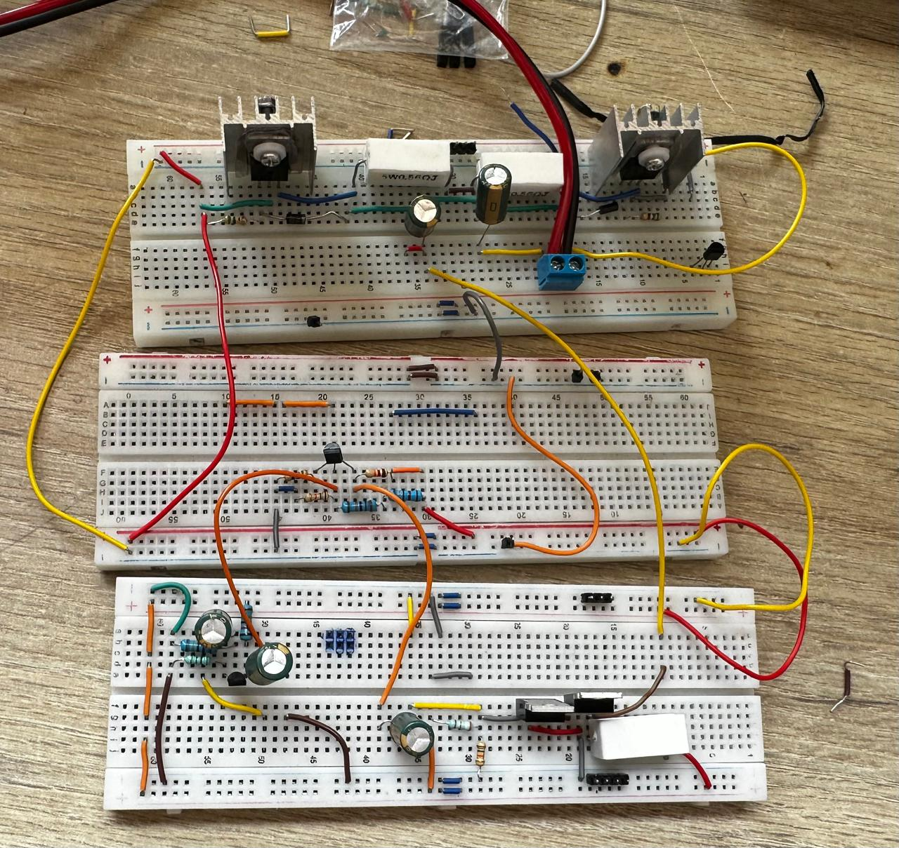

# Amplificador de Potencia Multietapa Clase AB

Amplificador de audio de cuatro etapas (JFET → Emisor Común → Colector Común Darlington → Push-Pull Clase AB) diseñado para llevar la señal de audio de un celular (~200 mVp) a un parlante de 8 Ω, buscando la mayor potencia posible con transistores discretos.

Proyecto de **Electrónica I** — Universidad de Ibagué, 2026-1
Autores: Felipe Aviles Castro, Brahiam Alberto Campiño Romero

[](https://www.youtube.com/watch?v=2Uj_PoNgtI4)

---

## Especificaciones

| Parámetro | Valor |
|---|---|
| Entrada | 200 mVp (salida de audífonos de un celular) |
| Salida | ≈ 10 Vp sobre 8 Ω |
| Corriente pico en la carga | ≈ 1.25 Ap |
| Potencia de diseño | 6.25 W promedio senoidal (P = Vp² / 2R) |
| Medido (Fig. 14 del informe) | picos de 11.1 V → ≈ 15 W instantáneos pico, 5–8 W promedio estimados |
| Ganancia total de voltaje | Av ≈ 50 |
| Alimentación | 25 V (etapas EC y Clase AB) |
| Carga | Parlante de 8 Ω |

## Arquitectura

```
Celular ─► [JFET 2SK30]  ─► [EC 2N3904] ─► [CC Darlington] ─► [Clase AB TIP31C/TIP32C] ─► Parlante 8 Ω
            Av ≈ 5           Av ≈ 10        Av ≈ 1, Ai ≈ 120    Av ≈ 1, ganancia de corriente
            Alta Zin         Ganancia       Buffer de impedancia Etapa de potencia
```

| Etapa | Dispositivo | Función | Ganancia |
|---|---|---|---|
| 1. Autopolarización | JFET 2SK30 | Alta impedancia de entrada, no cargar la fuente | Av ≈ 5 |
| 2. Emisor común | 2N3904 (β ≈ 300) | Ganancia principal de voltaje | Av ≈ 10 |
| 3. Colector común Darlington | 2× TIP (β ≈ 18 000) | Buffer: adapta la baja Zin de la etapa AB | Ai ≈ 120 |
| 4. Push-pull Clase AB | TIP31C (NPN) / TIP32C (PNP), β ≈ 147 | Entregar corriente a la carga sin distorsión de cruce | Av ≈ 1 |

## Proceso de diseño

El diseño se hizo **de la salida hacia la entrada**: la etapa Clase AB fija la carga que ven las etapas anteriores.

1. **Clase AB:** a partir de 10 Vp sobre 8 Ω se dimensionaron la corriente de base y la polarización con diodos. La Zin inicial resultó demasiado baja, así que se subió el voltaje de polarización y se recalculó R2.
2. **Darlington:** un CC simple no daba suficiente ganancia de corriente para adaptar la Zin de la etapa AB a lo que necesitaba la etapa EC; con Darlington se llegó a Zin ≈ 12 kΩ.
3. **Emisor común:** RE = 600 Ω a partir de la ganancia requerida; estabilidad térmica con el criterio RB = 0.1·β·RE.
4. **JFET:** polarización con la ecuación de Shockley (Vp = −2.44 V, IDSS = 2.3 mA, gm ≈ 1.42 mS).

Los cálculos completos a mano están en [`calculos/`](calculos/) y en el [informe](docs/informe.pdf).

## Simulación y PCB

- Esquemático y simulación en **Proteus** (el archivo .pdsprj no se conserva)
- Diseño de PCB (no fabricado):





## Resultados

| Señal | Imagen |
|---|---|
| Entrada (audio) |  |
| Salida etapa intermedia |  |
| Salida final sobre el parlante |  |

- En baja potencia el sistema funcionó al primer intento.
- En media potencia hubo que ajustar resistencias y cambiar la protoboard por falsos contactos y calentamiento localizado.
- El amplificador operó sin recalentamiento significativo en los transistores de potencia.



> **Nota:** las mediciones originales por etapa se perdieron después de la entrega. El informe corregido incluye al final una sección de fe de erratas con los errores de la versión entregada y los únicos datos recuperables, que son los que se leen en las capturas del osciloscopio.

## Lecciones aprendidas

- En sistemas multietapa, pequeños cambios en la impedancia de entrada de una etapa alteran la polarización de la anterior: hay que diseñar de atrás hacia adelante e iterar.
- La resistencia de carga de la etapa EC debe ser menor que la del JFET para no inflar la resistencia reflejada.
- La protoboard no es adecuada para corrientes del orden de 1 A: falsos contactos y calentamiento. El siguiente paso es fabricar la PCB.

## Lista de materiales

| Cant. | Componente |
|---|---|
| 1 | JFET 2SK30 |
| 1 | 2N3904 |
| 2 | Transistores para el Darlington |
| 1 | TIP31C |
| 1 | TIP32C |
| — | Resistencias, condensadores de acople, diodos de polarización, disipadores |
| 1 | Parlante 8 Ω |

## Estructura del repositorio

```
├── README.md
├── docs/informe.pdf  # versión corregida, con fe de erratas
├── docs/latex/       # fuente LaTeX del informe
├── calculos/        # fotos de los cálculos a mano por etapa
└── img/             # esquemático, PCB, montaje y capturas de osciloscopio
```

## Referencias

1. A. Sedra y K. Smith, *Microelectronic Circuits*, 7th ed., Oxford University Press, 2015.
2. R. Boylestad y L. Nashelsky, *Electronic Devices and Circuit Theory*, 11th ed., Pearson, 2013.
3. P. Horowitz y W. Hill, *The Art of Electronics*, 3rd ed., Cambridge University Press, 2015.
